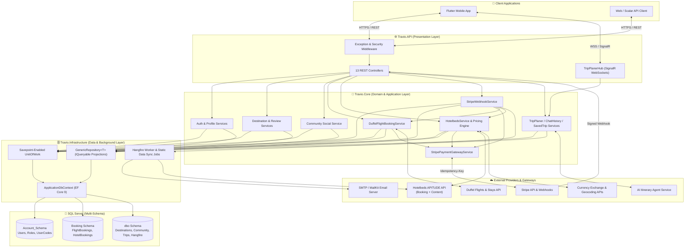
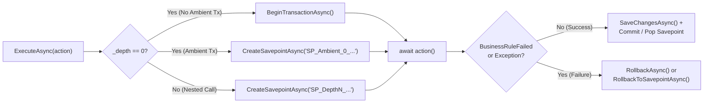
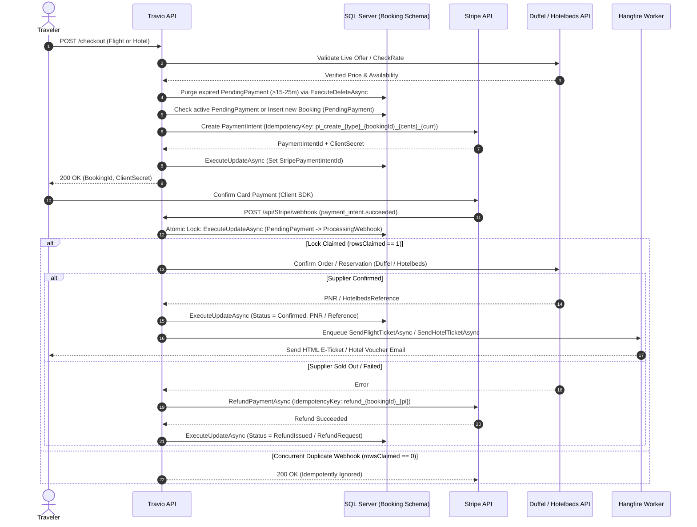
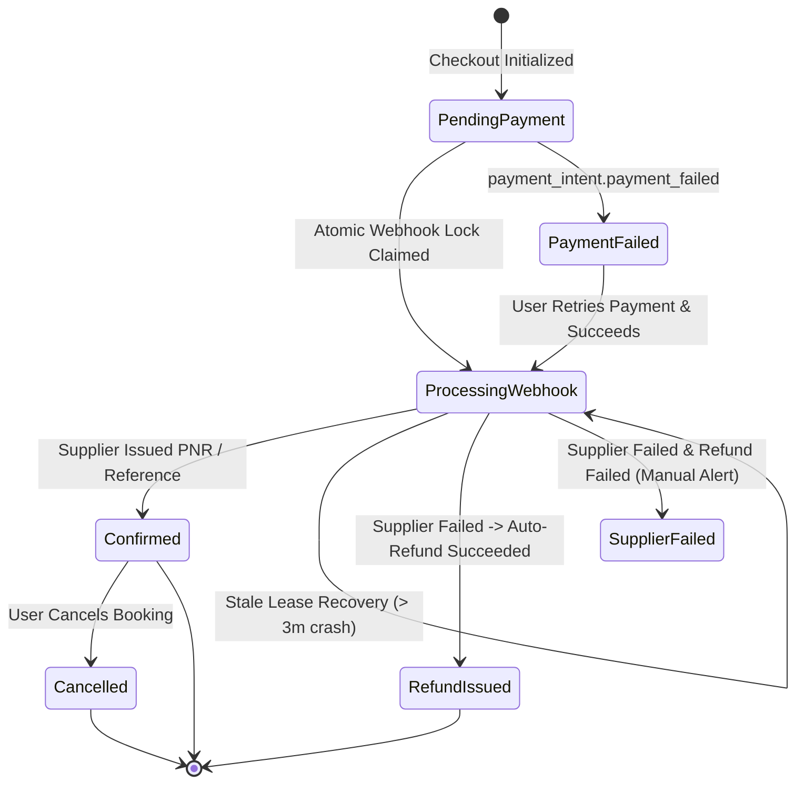
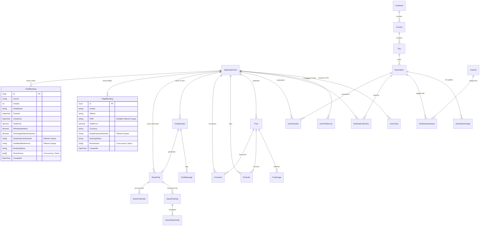

<p align="center">
  
</p>

<h1 align="center">Travio — Intelligent Travel Companion & Booking Engine</h1>

<p align="center">
  <strong>AI-Powered Trip Planning · Global Flight & Hotel Booking · High-Concurrency Stripe Payments · Social Travel Community</strong>
</p>

<p align="center">
  
  
  
  
  
  
  
  
</p>

---

## 📑 Table of Contents

1. [Overview & Business Value](#-overview--business-value)
2. [System Architecture Diagram](#-system-architecture-diagram)
3. [Engineering Highlights & Concurrency Design](#-engineering-highlights--concurrency-design)
4. [Payment & Booking Fulfillment Flows](#-payment--booking-fulfillment-flows)
5. [Database Schema & ER Diagram](#-database-schema--er-diagram)
6. [SQL Execution Plan & Index Optimizations](#-sql-execution-plan--index-optimizations)
7. [Core Platform Modules](#-core-platform-modules)
8. [Complete API Reference](#-complete-api-reference)
9. [Real-Time SignalR Protocol](#-real-time-signalr-protocol)
10. [Automated Unit Test Suite](#-automated-unit-test-suite)
11. [Getting Started](#-getting-started)

---

## 📖 Overview & Business Value

**Travio** is a full-lifecycle travel platform engineered with **ASP.NET Core 9** and **Clean Architecture**. It unifies fragmented travel workflows—inspiration, conversational AI itinerary generation, live airline ticketing, global hotel reservations, PCI-compliant payment processing, and social sharing—into a single high-throughput backend built for mobile (Flutter) and web applications.

| Journey Stage | Module | Capabilities |
| :--- | :--- | :--- |
| 🔍 **Discover** | **Destination Explorer** | Browse 1,000+ destinations with Haversine geospatial search, content-based similarity suggestions, and verified traveler reviews. |
| 🤖 **Plan** | **AI Trip Planner** | Real-time SignalR streaming chat that builds multi-day itineraries (days, timed activities, coordinates, and hotels) and auto-saves them atomically. |
| ✈️ **Fly** | **Duffel Flights Engine** | Live global airline search, offer validation, cabin/baggage breakdowns, and automated PNR issuance upon payment confirmation. |
| 🏨 **Stay** | **Hotelbeds APITUDE & Duffel Stays** | 180,000+ hotels with instant autocomplete, live rate checks, frozen wholesale-to-retail FX pricing, and automated voucher generation. |
| 💳 **Pay** | **Hardened Stripe Gateway** | Deterministic idempotency keys, optimistic concurrency (`RowVersion`), atomic webhook locking with stale-lease recovery, and auto-refunds on supplier failure. |
| 🌍 **Share** | **Traveler Community** | Social feed with multi-image posts, atomic like/unlike toggles, and threaded comments. |

---

## 🏗️ System Architecture Diagram

Travio enforces strict **Clean Architecture** boundaries where `Travio.Core` has zero dependency on database providers or presentation frameworks, and all data access flows through `IGenericRepository<T>` and a savepoint-enabled `IUnitOfWork`.



---

## ⚡ Engineering Highlights & Concurrency Design

### 1. Savepoint-Enabled `UnitOfWork` with Automatic Business-Rule Rollback
Rather than scattering manual transaction handling across services, `UnitOfWork` manages transaction depth (`_depth`) and a LIFO stack of SQL savepoints (`_savepoints`):
- **Outermost Scope (`_depth == 0`)**: Opens a new database transaction—or attaches to an existing ambient transaction via savepoint `SP_Ambient_0_{Guid}`.
- **Nested Scopes (`_depth > 0`)**: Creates granular SQL savepoints (`SP_Depth1_{Guid}`) before executing nested delegates.
- **Self-Healing Rollback**: Every `ServiceResponse<T>` implements `IServiceResult` (`bool BusinessRuleFailed => !Success`). If any business rule fails or an exception is thrown, `UnitOfWork` automatically rolls back the transaction (or rolls back to the active savepoint) without leaking partial writes.



### 2. Zero-Tracking SQL Projections & Set-Based Mutations
- **Direct DTO Projections**: Read paths never load tracked entity graphs into memory. Queries project directly to DTOs in SQL via `.Select(...)` over `_repo.GetQueryable().AsNoTracking()`.
- **Set-Based Bulk Operations**: State transitions, review aggregate recalculations, OTP revocations, and stale checkout cleanups execute directly in SQL via `ExecuteUpdateAsync` and `ExecuteDeleteAsync`.
- **Upsert Pattern**: High-contention writes (such as `DestinationService.UpsertMyReviewAsync` and `TripPlanerHub` session tracking) execute `ExecuteUpdateAsync` first and only invoke `AddAsync` when `rowsAffected == 0`.
- **Metadata-Driven Partial Updates (`SaveInclude`)**: Inspects EF Core primary key metadata (`FindPrimaryKey()`) to modify only whitelisted columns while protecting primary keys and preserving `[Timestamp] RowVersion` concurrency tokens.

### 3. Frozen Wholesale-to-Retail FX Pricing Engine (`HotelbedsService`)
Hotelbeds returns wholesale net prices in **EUR**. To prevent exchange-rate drift between checkout initialization and asynchronous webhook fulfillment, Travio freezes the financial parameters on the `HotelBooking` row at checkout:
$$\text{TotalPrice (USD)} = \text{Round}\left(\text{WholesaleNetEur} \times 1.15_{\text{Corporate Markup}} \times \text{ExchangeRateAtCheckout}, 2\right)$$

---

## 💳 Payment & Booking Fulfillment Flows

### Eliminating Double-Charge & Double-Booking Race Conditions
Concurrent mobile retries and simultaneous Stripe webhook deliveries are defended across **four layers**:
1. **Checkout Deduplication & Stale Cleanup**: Before creating a booking, expired `PendingPayment` rows (`> 25 mins` for hotels, `> 15 mins` for flights) are purged via `ExecuteDeleteAsync`, and active `PendingPayment` sessions for the same user + offer/hotel are reused idempotently.
2. **Deterministic Stripe Idempotency Keys**:
   - PaymentIntent Creation: `pi_create_{bookingType}_{bookingId:N}_{amountInCents}_{currency}`
   - Compensating Refund: `refund_{bookingId:N}_{paymentIntentId}`
3. **Atomic Set-Based Webhook Lock (`ExecuteUpdateAsync`) & 3-Minute Stale-Lease Recovery**:
   - When `payment_intent.succeeded` arrives, `StripeWebhookService` attempts an atomic `UPDATE ... SET BookingStatus = 'ProcessingWebhook', UpdatedAt = @now WHERE Id = @id AND (BookingStatus = 'PendingPayment' OR (BookingStatus = 'ProcessingWebhook' AND UpdatedAt < @staleThreshold))`.
   - If `rowsClaimed == 0`, the duplicate concurrent webhook exits immediately. If a worker pod crashed mid-webhook, Stripe's retry automatically recovers the lock after 3 minutes.
4. **Compensating Auto-Refunds**: If Duffel or Hotelbeds fails to confirm inventory after payment capture, `StripeWebhookService` automatically triggers an idempotent Stripe refund and transitions the booking to `RefundIssued` / `RefundRequest`.



### Booking Lifecycle State Machine



---

## 🗄️ Database Schema & ER Diagram

Travio organizes tables across logical SQL Server schemas (`Account_Schema`, `Booking`, and `dbo`):



---

## 🚀 SQL Execution Plan & Index Optimizations

High-concurrency booking and discovery tables are tuned with **Bounded Columns**, **Covering Indexes (`INCLUDE`)**, and **Filtered Unique Indexes** to eliminate Full Table Scans, Clustered Key Lookups, and TempDB Sort spills:

| Access Pattern | Index / Schema Optimization | Execution Plan Impact |
| :--- | :--- | :--- |
| **Webhook Lookup by `StripePaymentIntentId`** | Bounded `nvarchar(100)` + Filtered Unique Index `WHERE [StripePaymentIntentId] IS NOT NULL` | Replaced **Clustered Table Scan** (`nvarchar(max)`) with $O(\log N)$ **Unique Index Seek** (1 logical read, row-level lock only). |
| **User Hotel Bookings (`GetUserBookingsAsync`)** | Covering Index `IX_HotelBookings_UserId_CreatedAt (UserId ASC, CreatedAt DESC) INCLUDE (...)` + SQL `.Select(...)` | Eliminated **Key Lookups**, **TempDB Sort** operators, and 8KB `GuestDataJson` LOB page reads. |
| **User Flight Bookings** | Covering Index `IX_FlightBookings_UserId_CreatedAt (UserId ASC, CreatedAt DESC) INCLUDE (...)` | Single **Index Seek** pre-sorted by `CreatedAt DESC`. |
| **Duplicate Checkout Prevention** | Filtered Unique Indexes on `FlightBookings(UserId, OfferId)` & `HotelBookings(UserId, HotelId, CheckIn, CheckOut) WHERE [BookingStatus] = 'PendingPayment'` | Database-enforced guard against concurrent double-click checkouts while allowing unlimited historical bookings. |
| **Pre-Confirmation Flight PNR** | Nullable `PNR nvarchar(50)` + Filtered Unique Index `WHERE [PNR] IS NOT NULL` | Allows persisting `FlightBooking` before Stripe payment while enforcing global PNR uniqueness once confirmed. |

---

## 🧩 Core Platform Modules

```text
Travio.Solution/
├── Travio.API                     # Presentation Layer — Controllers, SignalR Hubs, Middleware
│   ├── Controllers/               # 13 REST API Controllers
│   ├── Hubs/                      # TripPlanerHub (SignalR real-time AI streaming & atomic trip save)
│   ├── Middleware/                # Global exception handling middleware
│   ├── Extensions/                # DI registration, Identity, Swagger/Scalar, Hangfire setup
│   └── Filters/                   # Endpoint performance & audit logging filters
│
├── Travio.Core                    # Domain & Application Layer
│   ├── Domain/
│   │   ├── Entities/              # Account, Community, Destinations, Duffel, Hotelbeds, TripPlaner
│   │   ├── Enums/                 # Strongly-typed lifecycle enums
│   │   └── InfrastructureContract/# IGenericRepository<T> & IUnitOfWork contracts
│   ├── Contracts/                 # Service abstractions (IPaymentGatewayService, IHotelbedsService, etc.)
│   ├── Services/                  # Business logic implementations (Rules 3 & 6 compliant)
│   ├── DTOs/                      # Modular request/response contracts & IServiceResult
│   └── Validators/                # FluentValidation rules
│
├── Travio.Infrastructure          # Persistence & Background Jobs Layer
│   ├── ApplicationDbContext.cs    # Multi-schema EF Core 9 DbContext
│   ├── Configrations/             # Fluent API configurations, Covering & Filtered Indexes
│   ├── Repositories/              # GenericRepository<T> & Savepoint-enabled UnitOfWork
│   ├── Jobs/                      # Hangfire background jobs (HotelbedsStaticDataSyncJob)
│   └── Migrations/                # Code-First EF Core migrations
│
└── Travio.UnitTests               # Automated Relational Test Suite
    ├── Fixtures/                  # SqliteTestDbContext (In-Memory relational SQLite harness)
    ├── Repositories/              # GenericRepository<T>, SaveInclude & UnitOfWork savepoint tests
    └── Services/                  # StripeWebhook, Hotelbeds, Duffel, Destination, Community & Trip tests
```

---

## 🔌 Complete API Reference

### 1. Authentication (`/api/Auth`)
| Method | Endpoint | Auth | Description |
| :--- | :--- | :---: | :--- |
| `POST` | `/api/Auth/register` | Public | Register a new traveler account and dispatch verification OTP |
| `POST` | `/api/Auth/login` | Public | Authenticate and receive JWT + rotating refresh token |
| `POST` | `/api/Auth/google-login` | Public | Authenticate via Google OAuth 2.0 `IdToken` |
| `POST` | `/api/Auth/refreshToken` | Public | Rotate expired access token using refresh token |
| `POST` | `/api/Auth/Logout` | Public | Revoke active refresh token |
| `POST` | `/api/Auth/send-verify-email-otp` | Public | Resend 6-digit email verification OTP (with 60s cooldown) |
| `POST` | `/api/Auth/verify-email` | Public | Confirm email address using 6-digit OTP |
| `POST` | `/api/Auth/forgot-password` | Public | Send password reset OTP |
| `POST` | `/api/Auth/verify-reset-password-otp` | Public | Validate password reset OTP |
| `POST` | `/api/Auth/reset-password` | Public | Reset password using verified OTP |
| `POST` | `/api/Auth/send-test` | Public | Test SMTP HTML email delivery |

### 2. Profile & Onboarding Survey (`/api/Profile` & `/api/Survey`)
| Method | Endpoint | Auth | Description |
| :--- | :--- | :---: | :--- |
| `GET` | `/api/Profile` | 🔒 | Retrieve current user profile |
| `PUT` | `/api/Profile/update-profile` | 🔒 | Update personal details |
| `POST` | `/api/Profile/upload-image` | 🔒 | Upload profile avatar (`multipart/form-data`) |
| `GET` | `/api/Survey/onboarding` | Public | Retrieve onboarding travel preference questions |
| `POST` | `/api/Survey/user-preferences` | 🔒 | Batch-save user travel preferences |

### 3. Destinations, Reviews & Favorites (`/api/Destinations` & `/api/Favorites`)
| Method | Endpoint | Auth | Description |
| :--- | :--- | :---: | :--- |
| `GET` | `/api/Destinations` | 🔒 | Paginated destinations filterable by city, country, interest, and sort order |
| `GET` | `/api/Destinations/{id}` | 🔒 | Get destination details |
| `GET` | `/api/Destinations/{id}/suggested` | 🔒 | Content-based similar destinations in the same city/country |
| `GET` | `/api/Destinations/top-rated` | 🔒 | Top-rated destinations |
| `GET` | `/api/Destinations/search` | 🔒 | Keyword and multi-interest search |
| `GET` | `/api/Destinations/nearby` | 🔒 | Haversine geospatial search by `latitude`, `longitude`, and `radiusKm` |
| `GET` | `/api/Destinations/famous-countries` | 🔒 | Featured countries with flags and imagery |
| `GET` | `/api/Destinations/{destinationId}/reviews` | 🔒 | Paginated reviews with ownership flag (`isMine`) |
| `POST` | `/api/Destinations/{destinationId}/reviews` | 🔒 | Atomic Upsert review & recalculate destination rating in SQL |
| `PUT` | `/api/Destinations/{destinationId}/reviews/me` | 🔒 | Update current user's review |
| `DELETE` | `/api/Destinations/{destinationId}/reviews/me` | 🔒 | Soft-delete review & refresh rating aggregates |
| `POST` | `/api/Favorites/{destinationId}` | 🔒 | Add destination to user favorites |
| `DELETE` | `/api/Favorites/{destinationId}` | 🔒 | Remove destination from favorites |
| `GET` | `/api/Favorites` | 🔒 | Paginated list of favorite destinations |

### 4. Flight Booking (`/api/FlightBooking`)
| Method | Endpoint | Auth | Description |
| :--- | :--- | :---: | :--- |
| `GET` | `/api/FlightBooking/flights/search` | Public | Live flight search via Duffel API |
| `GET` | `/api/FlightBooking/top-offers` | Public | Curated flight deals across major hubs |
| `GET` | `/api/FlightBooking/{offerId}` | Public | Full offer details, segments, and baggage conditions |
| `POST` | `/api/FlightBooking/checkout` | 🔒 | Validate live price, persist `FlightBooking`, and create idempotent Stripe `PaymentIntent` |

### 5. Hotel Booking (`/api/Hotels` & `/api/DuffelHotels`)
| Method | Endpoint | Auth | Description |
| :--- | :--- | :---: | :--- |
| `GET` | `/api/Hotels/destinations/search` | Public | Fast SQL-projected destination autocomplete |
| `POST` | `/api/Hotels/search` | Public | Live Hotelbeds availability with EUR→USD FX & 15% markup |
| `GET` | `/api/Hotels/{hotelCode}/details` | Public | Full property details, room rates, photos, and facilities |
| `POST` | `/api/Hotels/check-rate` | Public | Confirm rate key price & cancellation policies before checkout |
| `POST` | `/api/Hotels/checkout` | 🔒 | Freeze FX rate, persist `HotelBooking`, and initialize idempotent Stripe `PaymentIntent` |
| `GET` | `/api/Hotels/my-bookings` | 🔒 | Covering-index query returning user's hotel bookings |
| `GET` | `/api/Hotels/bookings/{reference}` | 🔒 | Live booking detail from Hotelbeds (with ownership check) |
| `DELETE` | `/api/Hotels/bookings/{reference}` | 🔒 | Cancel confirmed hotel booking on Hotelbeds and update DB |
| `GET` | `/api/DuffelHotels/search` | Public | Alternative hotel search via Duffel Stays API |
| `GET` | `/api/DuffelHotels/details/{searchResultId}` | Public | Duffel Stays property & room rate details |

### 6. Payments (`/api/Stripe`)
| Method | Endpoint | Auth | Description |
| :--- | :--- | :---: | :--- |
| `POST` | `/api/Stripe/webhook` | Stripe-Signature | Processes `payment_intent.succeeded` and `payment_intent.payment_failed` with atomic lock acquisition, supplier fulfillment, compensating refunds, and Hangfire ticket emails |

### 7. Community Social Feed (`/api/Community`)
| Method | Endpoint | Auth | Description |
| :--- | :--- | :---: | :--- |
| `POST` | `/api/Community/create-post` | 🔒 | Publish a new community travel post |
| `POST` | `/api/Community/posts/{postId}/images` | 🔒 | Upload image gallery to a post |
| `GET` | `/api/Community/feed` | 🔒 | Paginated social feed with SQL-projected counts |
| `GET` | `/api/Community/posts/{postId}` | 🔒 | Detailed post view with comments and like status |
| `POST` | `/api/Community/posts/{postId}/toggle-like` | 🔒 | Like or unlike a post |
| `POST` | `/api/Community/posts/{postId}/comments` | 🔒 | Add a comment to a post |
| `DELETE` | `/api/Community/comments/{commentId}` | 🔒 | Delete own comment |
| `DELETE` | `/api/Community/posts/{postId}` | 🔒 | Delete own post |

### 8. AI Trip Planner, Chat History & Saved Trips (`/api/Ai`, `/api/chat`, `/api/Trip`)
| Method | Endpoint | Auth | Description |
| :--- | :--- | :---: | :--- |
| `POST` | `/api/Ai/chat` | Public | Send message to AI trip planner |
| `GET` | `/api/Ai/status/{threadId}` | Public | Poll AI itinerary generation status |
| `GET` | `/api/chat/sessions` | 🔒 | Paginated list of user's AI chat sessions |
| `GET` | `/api/chat/sessions/{id}/messages` | 🔒 | Paginated messages in a chat session |
| `DELETE` | `/api/chat/sessions/{id}` | 🔒 | Delete a chat session and its messages |
| `GET` | `/api/Trip` | 🔒 | Paginated list of saved AI trips |
| `GET` | `/api/Trip/favorites` | 🔒 | Paginated list of favorite trips |
| `GET` | `/api/Trip/{id}` | 🔒 | Full trip hierarchy (Days, Timed Activities, Hotels) |
| `POST` | `/api/Trip/{id}/favorite` | 🔒 | Toggle favorite status on a saved trip |
| `DELETE` | `/api/Trip/{id}` | 🔒 | Delete a saved trip |

---

## 📡 Real-Time SignalR Protocol (`TripPlanerHub`)

- **Hub Endpoint**: `wss://{host}/hubs/trip-planer?access_token={JWT_TOKEN}`
- **Client → Server Method**: `SendMessage(string message, string? threadId)`
- **Server → Client Events**:
  - `ReceiveStatus` — AI processing status updates (`thinking`)
  - `ReceiveMessageChunk` — Typewriter-streamed response chunks
  - `MessageComplete` — Turn completion metadata (`sessionId`, `threadId`, `status`)
  - `ReceiveItineraryStatus` — Full structured multi-day itinerary JSON
  - `TripSaved` — Emitted once the `SavedTrip` graph (`Days`, `Activities`, `Hotels`) is atomically committed via `UnitOfWork`

---

## 🧪 Automated Unit Test Suite

The solution includes **`Travio.UnitTests`**, built with **xUnit**, **Moq**, **FluentAssertions**, and a relational **SQLite In-Memory** test harness (`SqliteTestDbContext`) that validates real SQL transactions, nested savepoints, `ExecuteUpdateAsync`, `ExecuteDeleteAsync`, and LINQ-to-SQL `.Select(...)` projections.

```bash
dotnet test Travio.Solution.sln
```

| Test Suite | Coverage Highlights |
| :--- | :--- |
| **`GenericRepositoryAndUnitOfWorkTests`** | • `GenericRepository<T>` CRUD & `.Select(...)` projections<br>• `SaveInclude` partial property updates while protecting Primary Keys & `RowVersion` concurrency tokens<br>• Automatic transaction rollback when `IServiceResult.BusinessRuleFailed == true`<br>• Automatic rollback on unhandled exceptions<br>• Nested savepoints (`SP_Depth1_...`) rolling back inner failed scopes while committing outer scopes |
| **`PaymentAndBookingServiceTests`** | • Hotel & Flight `StripeWebhookService` atomic lock acquisition (`ProcessingWebhook`)<br>• Concurrent duplicate webhook idempotency (prevents double-booking on supplier)<br>• 3-minute stale-lease recovery after simulated worker crash<br>• Automatic compensating refund (`RefundPaymentAsync`) when supplier fails after capture<br>• Hangfire `SendHotelTicketAsync` & `SendFlightTicketAsync` job enqueue verification<br>• `HotelbedsService` SQL projections (`SearchDestinationsAsync` & `GetUserBookingsAsync`) |
| **`CoreDomainServicesTests`** | • `DestinationService` search, review upsert (`ExecuteUpdateAsync` → `AddAsync`), soft-delete, and SQL aggregate recalculation<br>• `UserFavoriteService` add, duplicate guard, projection, and `ExecuteDeleteAsync`<br>• `CommunityService` post creation, like/unlike toggling, comments, and deletions<br>• `SurveyService`, `ChatHistoryService`, and `SavedTripService` projections & mutations |

---

## 🚀 Getting Started

### Prerequisites
- [.NET 9.0 SDK](https://dotnet.microsoft.com/download/dotnet/9.0)
- [SQL Server](https://www.microsoft.com/sql-server) (LocalDB, Developer, or Docker container)
- [Stripe CLI](https://stripe.com/docs/stripe-cli) (for local webhook forwarding)

### 1. Clone & Configure Secrets
```bash
git clone https://github.com/MahmoudAmin5/Travio.git
cd Travio/Travio.Solution

dotnet user-secrets init --project Travio.API
dotnet user-secrets set "ConnectionStrings:DefaultConnection" "Server=.;Database=TravioDb;Trusted_Connection=True;TrustServerCertificate=True;" --project Travio.API
dotnet user-secrets set "JWTSetting:Key" "YOUR_SUPER_SECRET_256_BIT_JWT_KEY_HERE" --project Travio.API
dotnet user-secrets set "Stripe:SecretKey" "sk_test_..." --project Travio.API
dotnet user-secrets set "Stripe:WebhookSecret" "whsec_..." --project Travio.API
dotnet user-secrets set "Duffel:AccessToken" "duffel_test_..." --project Travio.API
dotnet user-secrets set "HotelbedsSettings:ApiKey" "YOUR_HOTELBEDS_KEY" --project Travio.API
dotnet user-secrets set "HotelbedsSettings:SharedSecret" "YOUR_HOTELBEDS_SECRET" --project Travio.API
```

### 2. Apply EF Core Migrations & Run
```bash
dotnet ef database update --project Travio.Infrastructure --startup-project Travio.API
dotnet run --project Travio.API
```
- **Scalar Interactive API Docs**: `https://localhost:5001/scalar/v1`
- **Hangfire Dashboard**: `https://localhost:5001/hangfire`

### 3. Forward Stripe Webhooks Locally
```bash
stripe listen --forward-to https://localhost:5001/api/Stripe/webhook
```

---

## 📄 License

This project is licensed under the MIT License — see the [LICENSE](LICENSE) file for details.

<p align="center">
  Built with ❤️ by the <strong>Travio Engineering Team</strong>
</p>
